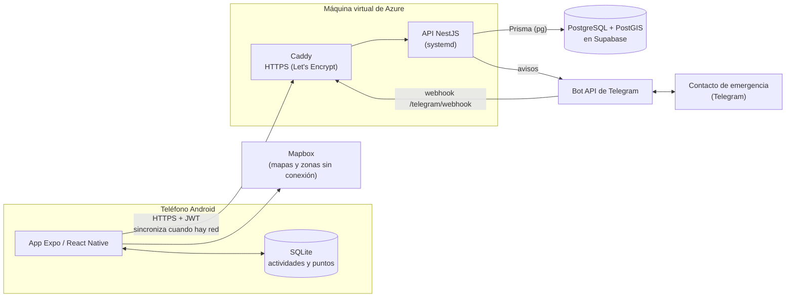

# SendaBC

App móvil para registrar actividades al aire libre (senderismo, trail running y ciclismo) en Baja California. Graba el recorrido con GPS aunque no haya señal, calcula distancia, tiempo y desnivel, muestra rutas cercanas en un mapa 2D y 3D, y avisa por Telegram a tus contactos de emergencia si dejas de moverte durante una actividad y no respondes.

- **Manual de uso:** [docs/manual.md](docs/manual.md)
- **Guion de la demo:** [docs/demo.md](docs/demo.md)
- **Especificaciones:** [specs/](specs/) (empieza por [roadmap.md](specs/roadmap.md))

## Contenido

1. [Arquitectura](#arquitectura)
2. [Stack](#stack)
3. [Estructura de carpetas](#estructura-de-carpetas)
4. [Metodología: Spec-Driven Development](#metodología-spec-driven-development)
5. [Requisitos](#requisitos)
6. [Variables de entorno](#variables-de-entorno)
7. [Levantar el proyecto en desarrollo](#levantar-el-proyecto-en-desarrollo)
8. [Pruebas y linter](#pruebas-y-linter)
9. [Instalar el APK de entrega](#instalar-el-apk-de-entrega)
10. [Compilar el APK otra vez](#compilar-el-apk-otra-vez)
11. [Despliegue del backend](#despliegue-del-backend)

## Arquitectura



- **Offline-first:** mientras grabas, la base local (SQLite) es la fuente de verdad. La actividad queda `PENDING_SYNC` y se sube al servidor cuando hay red. Cada actividad lleva un `client_generated_id` para que reintentar no la duplique.
- **Backend:** API REST en NestJS con autenticación JWT. Las rutas cercanas se calculan con PostGIS. Una tarea programada revisa cada minuto las horas de regreso vencidas.
- **Seguridad:** durante una actividad, la app detecta la inactividad, pregunta "¿Estás bien?" y, si no respondes, el servidor avisa a tus contactos por Telegram con tu última ubicación.

## Stack

| Capa | Tecnología |
|---|---|
| App móvil | Expo SDK 57, React Native 0.86, TypeScript |
| Navegación y datos remotos | React Navigation 7 (API estática), TanStack Query 5 |
| Dispositivo | `expo-location`, `expo-sensors` (barómetro), `expo-sqlite`, `expo-secure-store`, `expo-notifications`, `expo-task-manager`, `@rnmapbox/maps` |
| Interfaz | `expo-font`, `@expo/vector-icons`, `expo-system-ui`, `react-native-svg`, `expo-splash-screen` |
| Backend | NestJS 12, Passport (local + JWT), class-validator, `@nestjs/schedule` |
| Mensajería | Bot API de Telegram, llamada con `fetch` |
| Datos | Prisma 7 con `@prisma/adapter-pg`, PostgreSQL + PostGIS en Supabase |
| Calidad | Vitest + supertest, oxlint, Prettier, Postman |
| Despliegue | Máquina virtual de Azure for Students (systemd + Caddy), Supabase, Expo EAS Build |

La tabla oficial y sus reglas están en la [constitución](specs/constitution.md), artículo 7.

## Estructura de carpetas

```
SendaBC/
├── backend/                 API NestJS
│   ├── src/                 un módulo por dominio: auth, user, activity, route,
│   │                        emergency-contact, safety, telegram
│   ├── prisma/              schema.prisma, migraciones, seeds y consultas
│   ├── test/                pruebas e2e (*.e2e-spec.ts)
│   ├── postman/             colección y entorno de producción
│   └── deploy/              systemd, Caddy, actualizar.sh y api.env.ejemplo
├── frontend/                app Expo
│   ├── App.tsx              navegación y proveedores
│   ├── pages/               pantallas
│   ├── components/          componentes de interfaz
│   ├── hooks/               hooks por dominio (grabación, sincronización…)
│   ├── lib/                 lógica sin React: SQLite, métricas, sincronización, seguridad, mapas, tema
│   ├── modules/barometro/   módulo nativo del barómetro
│   ├── plugins/             config plugins propios
│   ├── app.json · app.config.ts · eas.json
│   └── assets/              íconos, fuentes y logos
├── specs/                   especificaciones (fuente de verdad del proyecto)
└── docs/                    manual de uso y guion de la demo
```

## Metodología: Spec-Driven Development

Todo cambio de funcionalidad empieza en `specs/` y sigue este orden:

1. **`spec.md`:** qué y por qué. Historias de usuario y criterios de aceptación (`CA-x`) verificables.
2. **`plan.md`:** cómo. Endpoints, modelos, pantallas y decisiones, respetando la [constitución](specs/constitution.md).
3. **`tasks.md`:** tareas ordenadas; cada una cita los `CA-x` que cubre.
4. **Implementación:** una tarea a la vez, marcándola `[x]` al terminar.
5. **Verificación:** cada `CA-x` se comprueba con una prueba automatizada o con un caso manual documentado en `tasks.md`.

Cada funcionalidad tiene su carpeta (`specs/001-registro-usuario/` … `specs/015-filtros-y-ajustes/`). El estado de todas está en [specs/roadmap.md](specs/roadmap.md). Las plantillas están en `specs/_templates/`. Los commits citan la spec: `feat(003): guardar puntos GPS en SQLite`.

## Requisitos

- **Node.js 24 LTS** y npm.
- **Git**.
- Para compilar la app en tu computadora:
  - **JDK 21** con `JAVA_HOME` apuntando a él (por ejemplo, el OpenJDK 21 de Android Studio);
  - **Android SDK** (Android Studio), con un emulador o un teléfono Android con depuración USB.
- Cuentas gratuitas:
  - [Supabase](https://supabase.com), para la base de datos;
  - [Mapbox](https://mapbox.com), para el token público de los mapas;
  - opcional: Telegram y un bot creado con [@BotFather](https://t.me/BotFather), para probar los avisos reales;
  - opcional: [Expo](https://expo.dev), para compilar el APK con EAS.

## Variables de entorno

Ningún secreto va en el repositorio (constitución 3.6). Copia los ejemplos y llena tus valores; los archivos reales están en `.gitignore`.

### Backend: `backend/.env` (desde [`backend/.env.example`](backend/.env.example))

| Variable | Para qué sirve | Ejemplo (no real) |
|---|---|---|
| `DATABASE_URL` | Conexión de la API a PostgreSQL. En Supabase, la del *Transaction pooler* (puerto 6543). | `postgresql://<usuario>:<contraseña>@<host-del-pooler>:6543/postgres?pgbouncer=true` |
| `DIRECT_URL` | Conexión para las migraciones de Prisma. En Supabase, la del *Session pooler* (puerto 5432). | `postgresql://<usuario>:<contraseña>@<host-del-pooler>:5432/postgres` |
| `JWT_SECRET` | Secreto con el que se firman los tokens de sesión. Una cadena larga y aleatoria. | `cambia-esto-por-un-secreto-largo` |
| `JWT_EXPIRE_IN` | Vigencia del token. | `7d` |
| `PORT` | Puerto de la API (opcional; 3000 por omisión). | `3000` |
| `CORS_ORIGIN` | Origen permitido por CORS (opcional; solo para la versión web). | `http://localhost:8081` |
| `TELEGRAM_MODE` | `log`: solo registra los avisos, sin enviarlos (por omisión en desarrollo). `polling`: bot real sin webhook. `webhook`: producción. | `log` |
| `TELEGRAM_BOT_TOKEN` | Token del bot (obligatorio con `polling` o `webhook`). | `<token-de-BotFather>` |
| `TELEGRAM_BOT_USERNAME` | Usuario del bot, para los enlaces de invitación. | `mi_bot_de_prueba_bot` |
| `TELEGRAM_WEBHOOK_SECRET` | Secreto que Telegram manda en cada webhook (obligatorio con `webhook`). | `<secreto-aleatorio>` |
| `MANUAL_TEST_EMAIL`, `MANUAL_TEST_PASSWORD`, `SEED_ACTIVIDADES_EMAIL`, `SEED_ACTIVIDADES_PASSWORD` | Solo locales: cuentas de algunos casos manuales y del seed de actividades. | `prueba@ejemplo.test` |

En producción, el modelo es [`backend/deploy/api.env.ejemplo`](backend/deploy/api.env.ejemplo).

### App: `frontend/.env.local` (desde [`frontend/.env.example`](frontend/.env.example))

| Variable | Para qué sirve | Ejemplo (no real) |
|---|---|---|
| `EXPO_PUBLIC_BACKEND_IP` | URL base del backend, sin barra final. | `http://localhost:3000` |
| `EXPO_PUBLIC_MAPBOX_TOKEN` | Token **público** de Mapbox (empieza con `pk.`). | `pk.tu-token-publico-de-mapbox` |
| `EXPO_PUBLIC_BATTERY_TEST` | Opcional. `1` agrega la vista "Sin mapa" para la prueba de batería. | `1` |
| `EXPO_PUBLIC_SAFETY_DEBUG_MINUTES` | Opcional, solo en desarrollo. Acorta la alerta por inactividad a N minutos. | `1` |

Las variables `EXPO_PUBLIC_*` quedan dentro de la app compilada: no pongas ahí nada secreto.

## Levantar el proyecto en desarrollo

### 1. Clonar e instalar

```powershell
git clone https://github.com/Blu18/SendaBC.git
cd SendaBC/backend
npm install
cd ../frontend
npm install
```

En el backend, `npm install` también genera el cliente de Prisma.

### 2. Base de datos en Supabase

1. Crea un proyecto en Supabase y anota la contraseña de la base.
2. En **Connect › Connection string**, copia la URL del *Transaction pooler* a `DATABASE_URL` y la del *Session pooler* a `DIRECT_URL` en `backend/.env`. Cambia `[YOUR-PASSWORD]` por tu contraseña.
3. Crea las tablas con las migraciones. Activan PostGIS, `pgcrypto` y el trigger que guarda las contraseñas como hash bcrypt:

   ```powershell
   cd backend
   npx prisma migrate deploy
   ```

4. Carga las rutas de ejemplo de Baja California. Las necesitan Explorar y las pruebas e2e:

   ```powershell
   npm run seed:rutas
   ```

Para cambiar el esquema después: edita `prisma/schema.prisma` y corre `npx prisma migrate dev --name <nombre>`.

### 3. Backend

```powershell
cd backend
npm run start:dev
```

La API queda en `http://localhost:3000` y responde `Hello World!` en `/`. Con `TELEGRAM_MODE=log`, los avisos a los contactos solo aparecen en la consola.

### 4. App (development build)

La app usa módulos nativos (Mapbox, barómetro, ubicación en segundo plano), así que no corre en Expo Go: necesita un *development build*.

1. Crea `frontend/.env.local` desde `frontend/.env.example`.
2. Con el emulador abierto o el teléfono conectado, compila e instala el build. La primera vez tarda varios minutos:

   ```powershell
   cd frontend
   npx expo run:android
   ```

   Si cambias plugins o la configuración nativa de `app.json`, regenera la carpeta `android/` antes: `npx expo prebuild --platform android --clean`.

3. Para los siguientes cambios de JavaScript basta con Metro:

   ```powershell
   npx expo start --dev-client
   ```

4. Para conectar la app al backend local:
   - **Emulador:** `adb reverse tcp:3000 tcp:3000` y `EXPO_PUBLIC_BACKEND_IP=http://localhost:3000`.
   - **Teléfono en la misma red:** la IP de tu computadora, por ejemplo `http://192.168.1.50:3000`.

   Reinicia Metro después de cambiar `.env.local`.

## Pruebas y linter

```powershell
cd backend
npm test                # pruebas unitarias (Vitest)
npm run test:e2e        # e2e contra la base de .env, archivo por archivo
npm run lint            # oxlint
npm run format          # Prettier
```

- Las e2e usan la base de `backend/.env` y crean y borran sus propios datos. En una base nueva, corre antes `npm run seed:rutas`.
- La colección de Postman está en `backend/postman/`. En local, el webhook simulado usa el secreto `postman-local`: arranca el backend con `TELEGRAM_WEBHOOK_SECRET=postman-local`. Para producción, importa también `SendaBC.produccion.postman_environment.json` y escribe en Postman el secreto real (nunca en la línea de comandos).

```powershell
cd frontend
npm test                # lógica pura de lib/ (Vitest)
npx tsc --noEmit        # revisión de tipos
```

Lo que depende del teléfono (GPS, mapas, notificaciones) se verifica con los casos manuales de cada `tasks.md`.

## Instalar el APK de entrega

El archivo `SendaBC-1.0.0.apk` va adjunto a la entrega. Usa el backend publicado, así que no necesitas levantar nada.

1. Si tienes instalado un development build de SendaBC, desinstálalo: las firmas son distintas.
2. Copia el APK al teléfono (cable, Drive o correo) y ábrelo desde el administrador de archivos.
3. Acepta instalar apps de ese origen cuando Android lo pida.
4. Abre **SendaBC**, crea una cuenta y concede el permiso de ubicación. Para la alerta con la pantalla bloqueada, elige "Permitir todo el tiempo".

## Compilar el APK otra vez

El APK se compila en la nube con EAS Build, perfil `entrega` de [`frontend/eas.json`](frontend/eas.json): APK de distribución interna que apunta al backend publicado.

1. Instala la CLI e inicia sesión:

   ```powershell
   npm install -g eas-cli
   eas login
   ```

2. Solo la primera vez en una cuenta nueva:
   - `eas init` agrega `extra.eas.projectId` a `app.json`;
   - carga el token público de Mapbox en el ambiente `production`:

   ```powershell
   eas env:set --name EXPO_PUBLIC_MAPBOX_TOKEN --value "pk.tu-token-publico" --environment production --visibility plaintext
   ```

3. Compila:

   ```powershell
   cd frontend
   eas build -p android --profile entrega
   ```

   EAS firma el APK con una llave que guarda en la cuenta. Al terminar, descarga el APK desde el enlace del build. Para una versión nueva, sube `android.versionCode` en `app.json`.

   Si cambia la URL del backend, edita `EXPO_PUBLIC_BACKEND_IP` en `eas.json`.

## Despliegue del backend

El backend publicado corre en una máquina virtual de **Azure for Students** con Ubuntu 24.04:
- **systemd** lo mantiene siempre encendido, para que la tarea de la hora de regreso corra cada minuto.
- **Caddy** da el HTTPS con un certificado de Let's Encrypt en un dominio gratuito de `sslip.io`.

Los archivos están en [`backend/deploy/`](backend/deploy/).

### Primera instalación

1. **Máquina.** Crea la máquina con la CLI de Azure. La suscripción de estudiante solo permite algunas regiones; `mexicocentral` funciona.

   ```powershell
   az group create -n sendabc-rg -l mexicocentral
   az vm create -g sendabc-rg -n sendabc-api --image Ubuntu2404 --size Standard_B2ats_v2 --admin-username azureuser --ssh-key-values ~/.ssh/id_ed25519.pub --public-ip-sku Standard --public-ip-address-allocation static --os-disk-size-gb 64 --storage-sku Premium_LRS
   az vm open-port -g sendabc-rg -n sendabc-api --port 80,443 --priority 1010
   ```

2. **Software.** En la máquina (`ssh azureuser@<ip>`), instala:
   - 2 GB de intercambio (`fallocate -l 2G /swapfile` …), porque la máquina tiene 1 GB de memoria;
   - Node 24 (NodeSource), Caddy (repositorio oficial de Caddy) y git.

3. **Usuario y repositorio.** Crea el usuario del servicio y clona el repositorio:

   ```bash
   sudo useradd --system --create-home --home-dir /var/lib/sendabc --shell /usr/sbin/nologin sendabc
   sudo install -d -o sendabc -g sendabc /opt/sendabc
   sudo -u sendabc git clone git@github.com:Blu18/SendaBC.git /opt/sendabc
   ```

   El repositorio es privado: genera una llave con `sudo -u sendabc ssh-keygen -t ed25519` y agrégala en GitHub como *deploy key* de solo lectura.

4. **Secretos.** Copia `backend/deploy/api.env.ejemplo` a `/etc/sendabc/api.env` (`640 root:sendabc`) y llena los valores. Genera los secretos con `openssl rand -base64 48` (`JWT_SECRET`) y `openssl rand -hex 32` (`TELEGRAM_WEBHOOK_SECRET`).

5. **Servicio y HTTPS.**
   - Copia `sendabc-api.service` a `/etc/systemd/system/` y actívalo con `systemctl enable`.
   - Agrega la regla de sudoers que trae `actualizar.sh` en su encabezado.
   - Copia el `Caddyfile` a `/etc/caddy/Caddyfile` con tu IP en el dominio (`203-0-113-10.sslip.io` → `<tu-ip-con-guiones>.sslip.io`) y corre `systemctl reload caddy`.

6. **Despliegue.** Corre:

   ```bash
   sudo -u sendabc /opt/sendabc/backend/deploy/actualizar.sh
   ```

   Hace `git pull`, `npm ci`, la compilación y `prisma migrate deploy`, reinicia el servicio y espera a que responda.

7. **Webhook de Telegram.** Registra el webhook del bot de producción desde la máquina, para que el token no salga de ella:

   ```bash
   sudo bash -c 'set -a; . /etc/sendabc/api.env; set +a; curl -s -X POST -H "Content-Type: application/json" \
     -d "{\"url\":\"https://<tu-ip-con-guiones>.sslip.io/telegram/webhook\",\"secret_token\":\"$TELEGRAM_WEBHOOK_SECRET\",\"allowed_updates\":[\"message\"]}" \
     "https://api.telegram.org/bot$TELEGRAM_BOT_TOKEN/setWebhook"'
   ```

### Actualizar

```bash
ssh azureuser@<ip>
sudo -u sendabc /opt/sendabc/backend/deploy/actualizar.sh
sudo journalctl -u sendabc-api -f      # registro del servicio
```
