# Manual de uso de SendaBC

SendaBC registra tus salidas de senderismo, trail running y ciclismo en Baja California, te muestra rutas cercanas y, si algo te pasa durante una actividad, avisa por Telegram a tus contactos de emergencia.

Las capturas son de la versión de entrega (`SendaBC-1.0.0.apk`) en un Samsung Galaxy S9+. Para instalarla, sigue el [README](../README.md#instalar-el-apk-de-entrega).

## Contenido

1. [Crear una cuenta e iniciar sesión](#1-crear-una-cuenta-e-iniciar-sesión)
2. [Inicio](#2-inicio)
3. [Grabar una actividad](#3-grabar-una-actividad)
4. [Resumen de la actividad](#4-resumen-de-la-actividad)
5. [Mis actividades y sus filtros](#5-mis-actividades-y-sus-filtros)
6. [Explorar rutas en 2D y 3D](#6-explorar-rutas-en-2d-y-3d)
7. [Publicar una ruta](#7-publicar-una-ruta)
8. [Favoritas y Mis rutas](#8-favoritas-y-mis-rutas)
9. [Contactos de emergencia](#9-contactos-de-emergencia)
10. [Alerta por inactividad, SOS y hora de regreso](#10-alerta-por-inactividad-sos-y-hora-de-regreso)
11. [Mapas sin conexión](#11-mapas-sin-conexión)
12. [Ajustes de la cuenta y de seguridad](#12-ajustes-de-la-cuenta-y-de-seguridad)
13. [Uso sin conexión](#13-uso-sin-conexión)
14. [Limitaciones conocidas](#14-limitaciones-conocidas)

---

## 1. Crear una cuenta e iniciar sesión

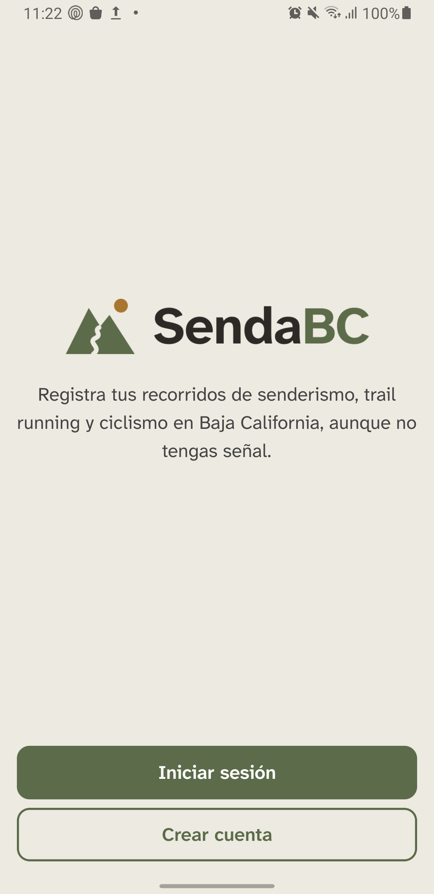 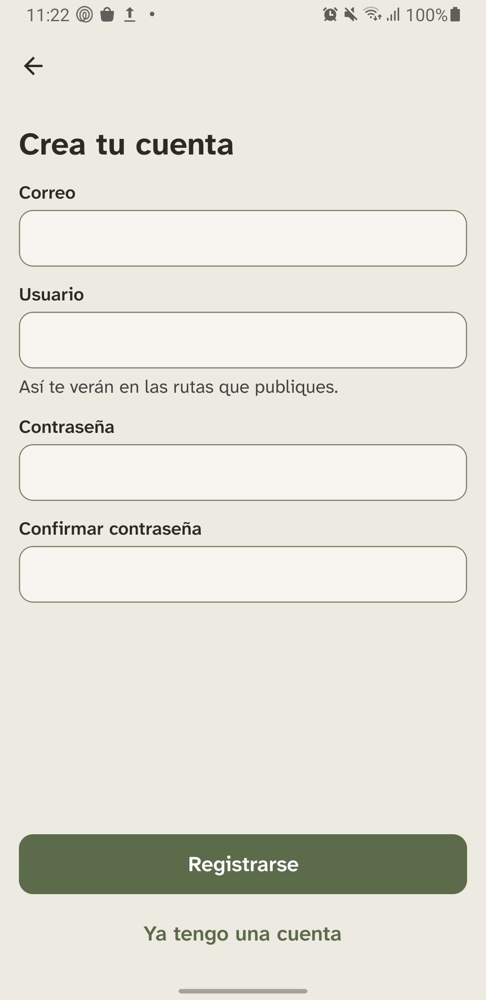

1. Abre SendaBC. En la bienvenida, toca **Crear cuenta**.
2. Escribe tu **correo**, tu **usuario** (así te verán en las rutas que publiques) y una **contraseña** de al menos 8 caracteres, dos veces. Toca **Registrarse**.
3. La app abre **Iniciar sesión** con tu correo ya escrito. Escribe tu contraseña y entra. La sesión se queda guardada: la próxima vez que abras SendaBC no tendrás que escribirla.

Si ya tienes cuenta, toca **Iniciar sesión** en la bienvenida. Para crear la cuenta o entrar necesitas conexión. Lo demás funciona sin ella (sección 13).

## 2. Inicio

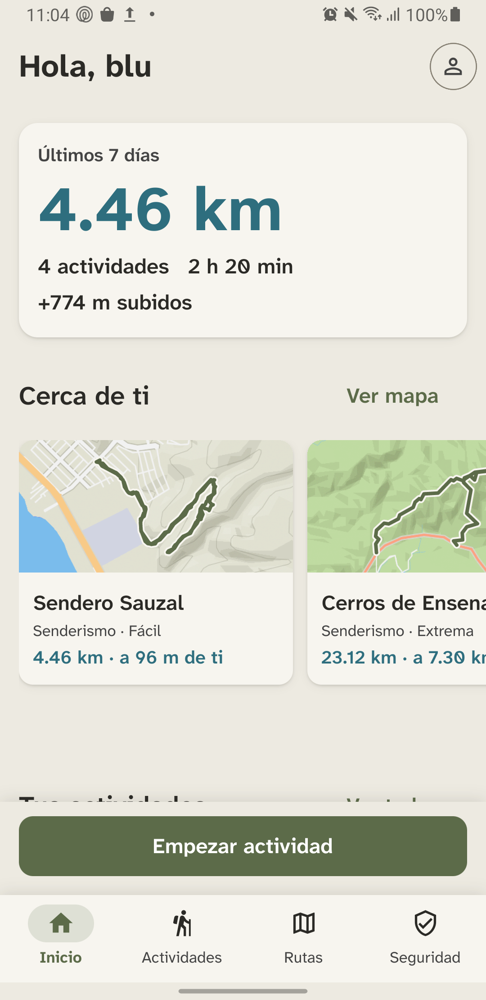

La pestaña **Inicio** reúne, de arriba abajo:

- **Últimos 7 días:** kilómetros, número de actividades, tiempo y metros subidos.
- **Cerca de ti:** rutas cercanas, con su distancia hasta ti. **Ver mapa** abre la pestaña Rutas.
- **Tus actividades:** las más recientes.
- **Populares:** las rutas que más gente guardó en favoritas.
- **Listo para salir:** si tienes contactos activos y el acceso a **Mapas sin conexión** (sección 11).
- **Empezar actividad:** el botón fijo de abajo.

El botón con tu avatar, arriba a la derecha, abre **Tu perfil** (sección 12).

Abajo están las cuatro pestañas: **Inicio**, **Actividades**, **Rutas** y **Seguridad**.

## 3. Grabar una actividad

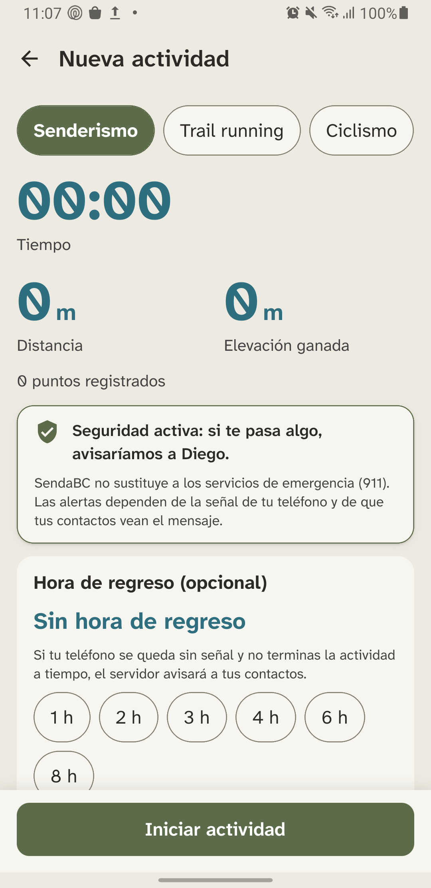 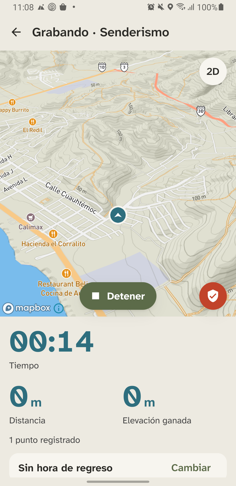 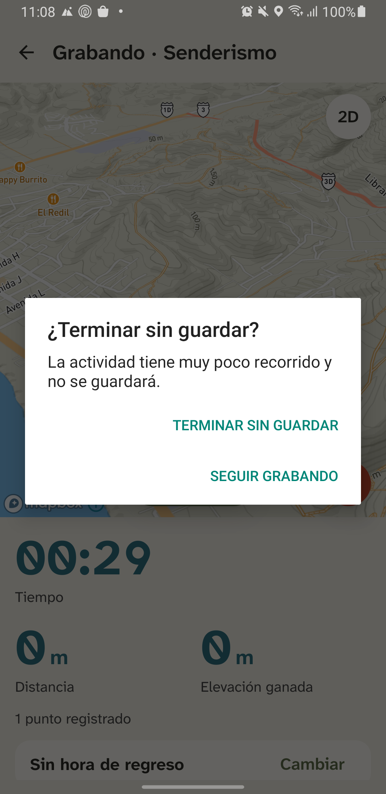

1. Toca **Empezar actividad** en Inicio o en Actividades.
2. Elige el tipo: senderismo, trail running o ciclismo.
3. Opcional: elige una **hora de regreso** (de 1 a 8 h; sección 10).
4. Toca **Iniciar actividad**. La primera vez, la app pide el permiso de ubicación. Para que siga grabando con la pantalla bloqueada, elige **Permitir todo el tiempo**.

Mientras grabas ves el tiempo, la distancia, la elevación ganada y los puntos registrados, debajo de un mapa con tu recorrido. El botón **2D/3D** cambia la vista del mapa, y el escudo rojo es el botón **SOS** (sección 10). Puedes bloquear la pantalla: la grabación sigue y una notificación lo indica.

Para terminar, toca **Detener**.

> **Actividades con muy poco recorrido.** Solo se guardan las actividades con al menos **3 puntos de GPS con buena precisión** (20 m o mejor). Si detienes una actividad que no llega a eso, por ejemplo porque no te moviste o el GPS no tenía señal, la app pregunta **"¿Terminar sin guardar?"**:
> - **Seguir grabando:** el cronómetro sigue corriendo.
> - **Terminar sin guardar:** la actividad se descarta y no aparece en ningún lado, ni en los totales de la semana.
>
> Lo mismo pasa si sales de la pantalla con la flecha de atrás, o si la app se cerró durante una actividad corta: al abrirla otra vez, la descarta sin preguntar.

## 4. Resumen de la actividad

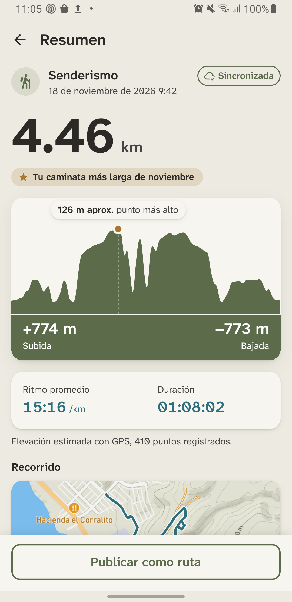

Al detener una actividad se abre su **Resumen**:

- la distancia y, si lo es, un logro (por ejemplo, "Tu caminata más larga de noviembre");
- el perfil de elevación, con el punto más alto marcado, la subida y la bajada;
- el ritmo promedio (la velocidad en ciclismo) y la duración;
- el mapa del recorrido.

Una nota dice de dónde sale la elevación: del barómetro del teléfono cuando lo tiene, o del GPS cuando no, y cuántos puntos se registraron.

Arriba a la derecha se ve si la actividad está **Sincronizada** o **pendiente de subir**. Desde el resumen puedes **Publicar como ruta** (sección 7).

## 5. Mis actividades y sus filtros

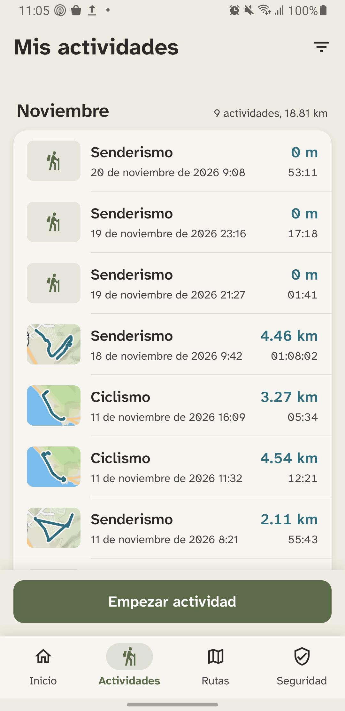 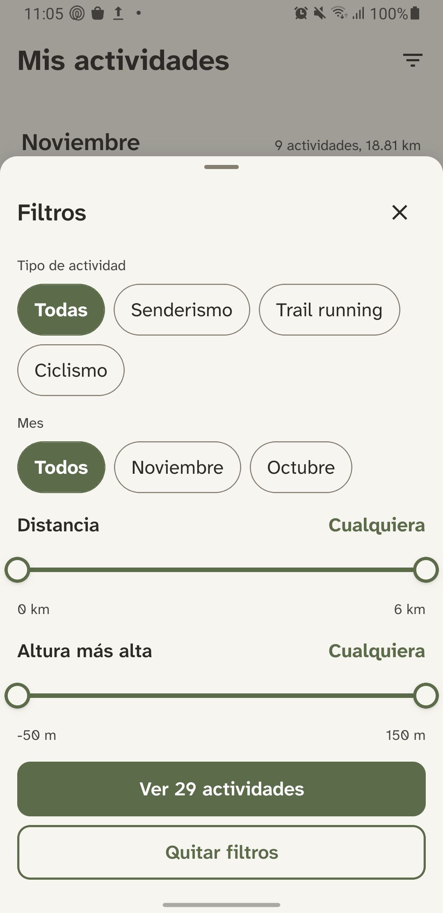

La pestaña **Actividades** muestra todas tus actividades agrupadas por mes, con el total de actividades y kilómetros de cada mes. Van de la más reciente a la más antigua, cada una con su miniatura del recorrido. Toca una para ver su resumen. Desliza hacia abajo para sincronizar con el servidor.

El botón de filtros, arriba a la derecha, abre un panel para filtrar por:

- **tipo** de actividad;
- **mes**;
- **distancia**, con un mínimo y un máximo;
- **altura más alta**, también con un mínimo y un máximo.

Los cambios se aplican al momento. **Ver N actividades** cierra el panel y **Quitar filtros** los quita todos. Si ninguna actividad cumple los filtros, la app lo dice y te ofrece quitarlos.

## 6. Explorar rutas en 2D y 3D

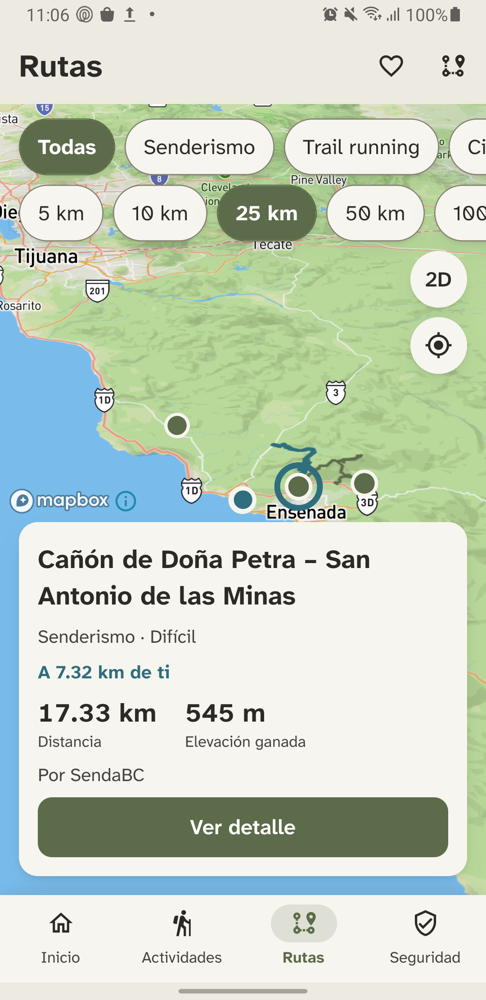 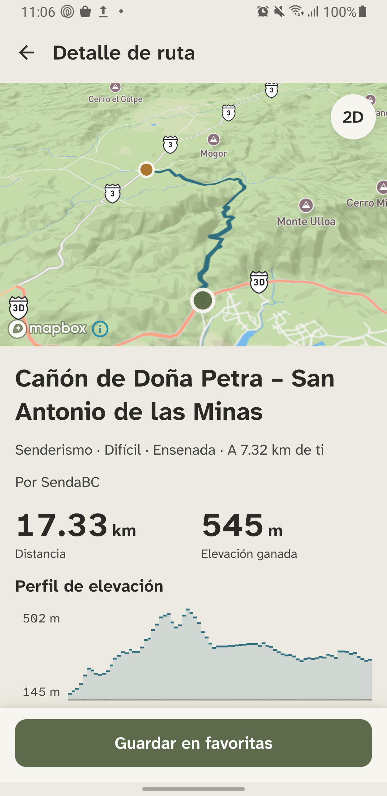 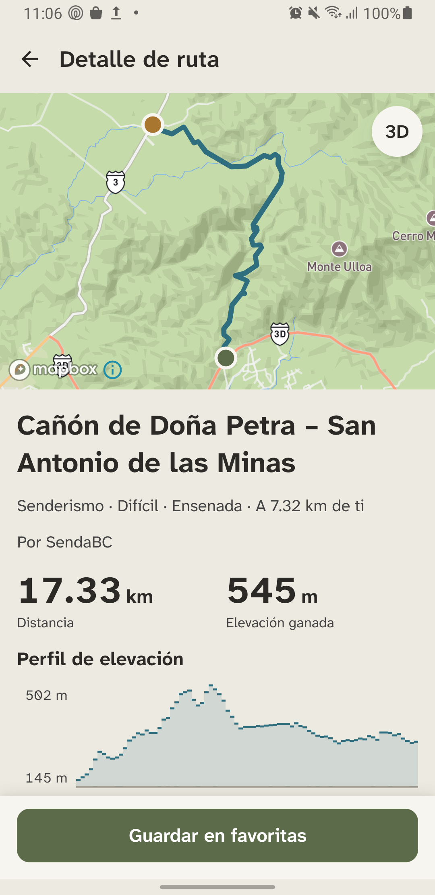

La pestaña **Rutas** muestra en un mapa las rutas cercanas a ti, cada una como un punto:

- Filtra por tipo de actividad y por radio de búsqueda (5, 10, 25, 50 o 100 km) con los botones de arriba. Si mueves el mapa, **Buscar en esta zona** busca rutas en el área que estás viendo.
- **2D/3D** cambia el mapa entre vista plana y relieve.
- **Centrar en mi ubicación** vuelve el mapa a donde estás.
- Toca un punto para ver la ruta en una tarjeta: su tipo, dificultad, distancia a ti, longitud, elevación ganada y autor. **Ver detalle** abre la ruta completa con su recorrido y su perfil de elevación. El mapa del detalle también cambia entre 3D y 2D.

## 7. Publicar una ruta

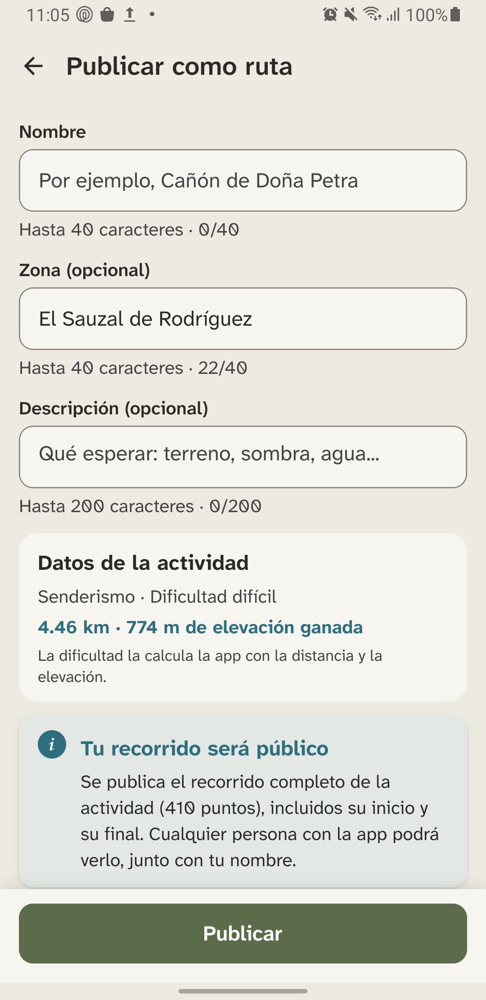

Puedes compartir una actividad tuya como ruta pública:

1. Abre el resumen de la actividad y toca **Publicar como ruta**.
2. Escribe el **nombre** (hasta 40 caracteres). La **zona** viene propuesta y puedes cambiarla, y la **descripción** es opcional (terreno, sombra, agua…). La dificultad la calcula la app con la distancia y la elevación.
3. Toca **Publicar**. El recorrido completo, con su inicio y su final, queda visible para cualquier persona con la app, junto con tu nombre.

Solo se publican actividades ya sincronizadas de al menos 1.5 km, y cada una una sola vez. Desde el detalle de una ruta tuya puedes editar su nombre y su zona, archivarla (deja de aparecer en Rutas) o borrarla.

## 8. Favoritas y Mis rutas

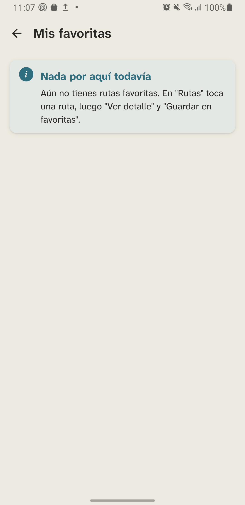

- En el detalle de cualquier ruta, toca **Guardar en favoritas**. **Quitar de favoritas** la saca de la lista.
- En la pestaña **Rutas**, los botones de arriba abren **Mis favoritas** (el corazón) y **Mis rutas** (las que publicaste, incluidas las archivadas). Mientras están vacías, cada pantalla explica cómo llenarla.

## 9. Contactos de emergencia

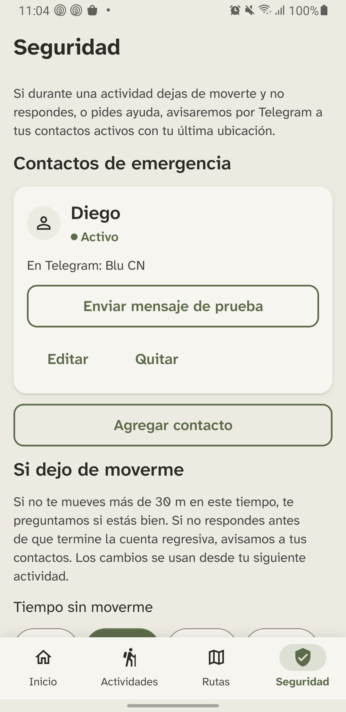

En la pestaña **Seguridad** agregas de uno a tres contactos de emergencia. Los avisos llegan por **Telegram**, así que tu contacto necesita tener Telegram.

1. Toca **Agregar contacto** y escribe su nombre.
2. Comparte la invitación por el medio que quieras (WhatsApp, SMS, correo…).
3. Tu contacto abre el enlace en Telegram y toca **Iniciar** en el bot `@senda_bc_bot`. Recibe un mensaje de bienvenida y en la app pasa de "Pendiente de aceptar" a **Activo**.
4. Con **Enviar mensaje de prueba** comprueba que le llegan tus avisos.

Si el contacto bloquea al bot o borra la conversación, aparece como "No recibe mensajes" y hay que invitarlo de nuevo.

## 10. Alerta por inactividad, SOS y hora de regreso

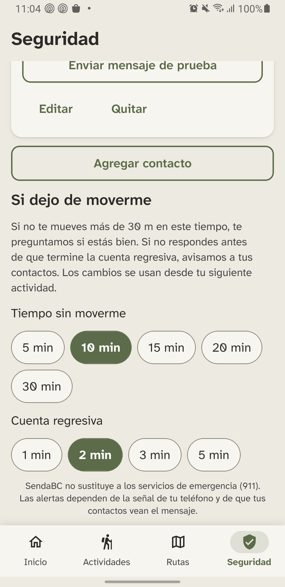 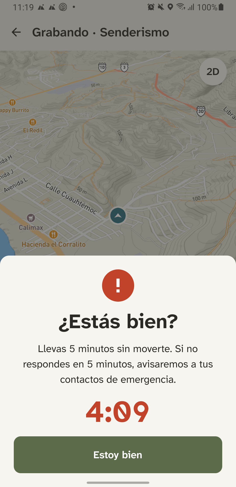

Mientras grabas una actividad y tienes contactos activos, SendaBC te cuida de tres formas.

**Inactividad.** Si no te mueves más de 30 m durante un tiempo, el teléfono vibra y pregunta **"¿Estás bien?"**, también con la pantalla bloqueada:
- **Estoy bien** cancela el aviso y la grabación sigue.
- Si no respondes antes de que termine la cuenta regresiva, se avisa por Telegram a tus contactos activos, con tu última ubicación en un mapa.

Los dos tiempos se eligen en **Seguridad › Si dejo de moverme**: **Tiempo sin moverme** (5, 10, 15, 20 o 30 min; 10 por omisión) y **Cuenta regresiva** (1, 2, 3 o 5 min; 2 por omisión). Los cambios se usan desde tu siguiente actividad.
- Si después respondes, tus contactos reciben un mensaje de que estás bien.

**SOS.** Mientras grabas, mantén presionado el escudo rojo (**SOS**) 2 segundos para avisar a tus contactos de inmediato, con tu ubicación.

**Hora de regreso (opcional).** Al iniciar puedes elegir en cuánto tiempo esperas terminar (de 1 a 8 h); durante la actividad, **Cambiar** la ajusta. La hora se guarda en el servidor. Si no terminas la actividad a esa hora, por ejemplo porque tu teléfono se quedó sin batería o sin señal, el servidor avisa a tus contactos que no has confirmado tu regreso.

> SendaBC **no sustituye a los servicios de emergencia (911)**. Las alertas dependen de la señal de tu teléfono y de que tus contactos vean el mensaje. Sin el permiso de ubicación "todo el tiempo", la detección de inactividad solo funciona con la app abierta y la pantalla encendida.

## 11. Mapas sin conexión

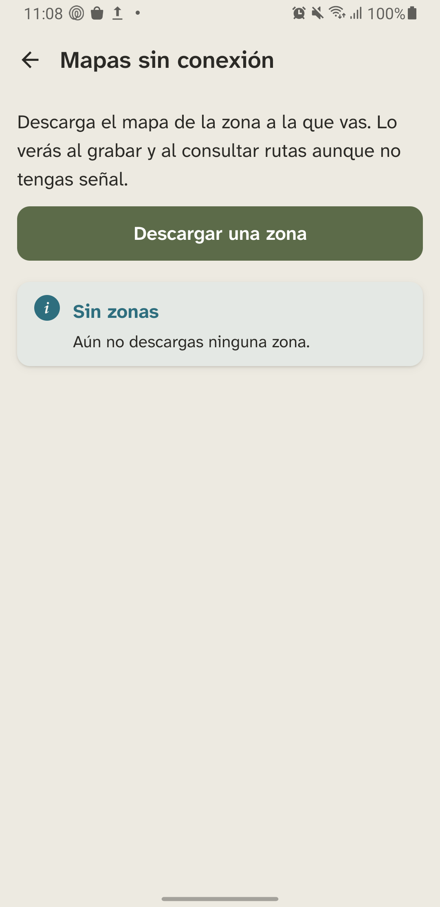 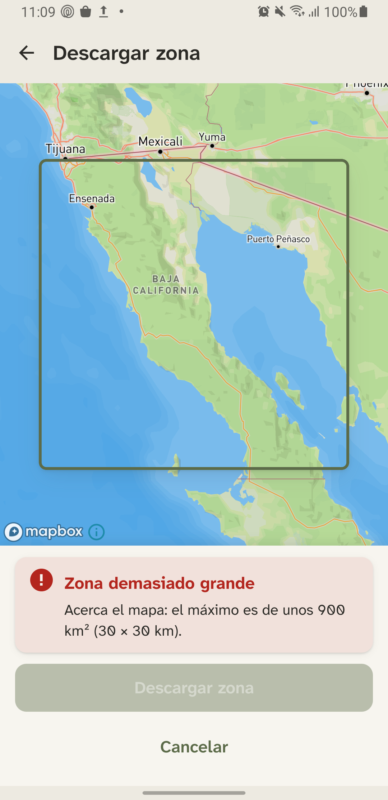

Antes de ir a un lugar sin señal, descarga el mapa de la zona:

1. En Inicio, abre **Mapas sin conexión**.
2. Toca **Descargar una zona** y mueve el mapa hasta que el recuadro cubra el área que quieres. El máximo es de unos 900 km² (30 × 30 km): si la zona es más grande, la app te pide acercar el mapa. Toca **Descargar zona**.
3. La zona queda guardada en el teléfono. Sin conexión, el mapa de la grabación y el de Rutas la usan.

Desde la misma pantalla puedes ver cuánto ocupa cada zona y borrarla.

## 12. Ajustes de la cuenta y de seguridad

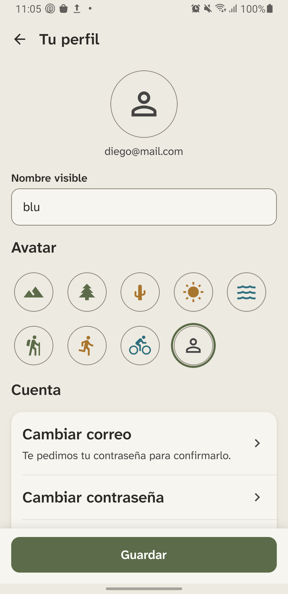

Toca tu avatar en Inicio para abrir **Tu perfil**. Ahí puedes:

- cambiar tu **nombre visible** y elegir un **avatar** (montañas, pino, cactus, sol, mar o un deportista) y tocar **Guardar**;
- **cambiar el correo** o **la contraseña** (pide tu contraseña actual);
- **cerrar sesión**: si tienes actividades sin subir, la app te avisa antes;
- **borrar tu cuenta**: borra tus actividades y contactos. Las rutas que publicaste se quedan, con el autor "Cuenta eliminada".

Los tiempos de la alerta por inactividad se ajustan en la pestaña Seguridad (sección 10). La app sigue el modo claro u oscuro del teléfono, y respeta el tamaño de letra y la reducción de animaciones del sistema.

## 13. Uso sin conexión

SendaBC está hecha para lugares sin señal:

- **Grabar no necesita internet.** Los puntos se guardan en el teléfono mientras grabas.
- Al terminar, la actividad queda **pendiente de subir** y se sube sola cuando vuelve la conexión. También puedes deslizar hacia abajo en Actividades. Nada se pierde si no hay red.
- **Actividades** e **Inicio** muestran tus actividades guardadas en el teléfono aunque no tengas conexión.
- Los mapas necesitan internet, salvo en las zonas que descargaste (sección 11).
- Con el teléfono sin señal, el aviso por inactividad no puede salir. Para eso está la **hora de regreso**, que vigila el servidor.

## 14. Limitaciones conocidas

- **Elevación con la pantalla bloqueada en teléfonos sin barómetro.** En teléfonos sin barómetro, la elevación sale del GPS. Si grabas con la pantalla bloqueada, el GPS puede dar menos puntos y menos precisos, y la elevación ganada puede salir mayor que la real. La distancia y el recorrido no se ven afectados (spec 011, F5).
- **Solo Android.** La versión de entrega es un APK para Android.
- **Avisos solo por Telegram.** Los contactos de emergencia necesitan Telegram.
